# Transaction Fraud Detection with a Cost-Based Decision Policy

> Detects fraudulent e-commerce transactions in a heavily imbalanced dataset (IEEE-CIS, ~590K transactions,
> ~3.5% fraud), evaluates with precision-recall and dollars instead of accuracy, and turns model scores into an
> **approve / review / decline** policy that minimizes fraud losses plus customer friction under an explicit,
> adjustable cost model.

**Stack:** Python · SQL (DuckDB) · pandas · LightGBM · scikit-learn · Optuna · MLflow · Altair · FastAPI · Streamlit · Docker · pytest · GitHub Actions

<!-- DRAFT: rewrite the paragraph below in your own voice -->
I built this as a portfolio project to practice the part of fraud work that most course projects skip: what
to actually *do* with a fraud score. A model that ranks transactions well is only half the job. The other half
is deciding where the cutoffs go, given what a missed fraud and a wrongly declined customer each cost, and how
many cases a review team can handle in a day.

## Results at a glance

<!-- BEGIN:headline -->
_Not generated yet: run `make all` on the Kaggle data, then `make writeup`._
<!-- END:headline -->


Every number in this README is generated from pipeline outputs in [`reports/`](reports/) by `make writeup`;
the blocks between `<!-- BEGIN -->` / `<!-- END -->` markers are overwritten on each run.

---

## Contents

1. [The business question](#1-the-business-question)
2. [Data](#2-data)
3. [How the pipeline works](#3-how-the-pipeline-works)
4. [What the data says (SQL analysis)](#4-what-the-data-says-sql-analysis)
5. [Features, and keeping them leak-free](#5-features-and-keeping-them-leak-free)
6. [Normalizing device, browser and email strings](#6-normalizing-device-browser-and-email-strings)
7. [Models](#7-models)
8. [From scores to decisions](#8-from-scores-to-decisions)
9. [Error analysis and explainability](#9-error-analysis-and-explainability)
10. [Does it hold up over time?](#10-does-it-hold-up-over-time)
11. [Serving: API and dashboard](#11-serving-api-and-dashboard)
12. [Limitations](#12-limitations)
13. [How this was built (AI-assisted development)](#13-how-this-was-built-ai-assisted-development)
14. [Reproduce](#14-reproduce)

---

## 1. The business question

> Given a fixed review capacity and a cost for every false alarm, which transactions should we approve, send to
> manual review, or decline, and how much fraud loss does that prevent versus the friction it creates?

A fraud team balances two failures:

| Error | What it costs |
|---|---|
| **Missed fraud** (approve a fraudulent transaction) | the chargeback: roughly the amount, plus a fee |
| **False alarm** (decline or challenge a good customer) | lost margin, a support contact, a customer less likely to come back |
| **Manual review** | analyst time, whether or not the case turns out to be fraud |

<!-- DRAFT: rewrite in your own words -->
**Why accuracy is useless here.** About 96.5% of transactions are legitimate, so a "model" that approves
everything is 96.5% accurate and catches nothing. Accuracy also treats every error as equally bad, and they
are not: missing a $2,000 fraud costs about 400 times more than missing a $5 one, while wrongly declining a
customer costs roughly the same whatever they were buying. So the right question is never "how often is the
model right?" but "how much money do its mistakes cost?", and the answer changes from one transaction to the
next.

## 2. Data

| Item | Detail |
|---|---|
| Source | [IEEE-CIS Fraud Detection](https://www.kaggle.com/competitions/ieee-fraud-detection) (Vesta Corporation, Kaggle) |
| Files | `train_transaction.csv` (590,540 rows) LEFT JOIN `train_identity.csv` (144,233 rows) on `TransactionID` |
| Target | `isFraud`, about 3.5% positive. Labels come from chargebacks |
| Time | `TransactionDT`: seconds from an **unknown** reference date, about 6 months. Usable for ordering and relative hour, not for calendar dates |
| Access | Competition rules forbid redistribution: [`data/README.md`](data/README.md) explains the download. Nothing row-level is committed |

Most of the ~430 columns are masked by the vendor (`V1-V339`, `C1-C14`, `D1-D15`, `M1-M9`, `id_01-id_38`):
their meaning is not published. The project uses them (they carry real signal) but leans on features whose
meaning is known when it explains decisions, and says so plainly when it can't.

**Why a LEFT join.** Only about a quarter of transactions have an identity row. An inner join would discard the
rest and change the population the model learns from:

<!-- BEGIN:sql_identity -->
_Not generated yet: run `make all` on the Kaggle data, then `make writeup`._
<!-- END:sql_identity -->

**The time split.** Fraud patterns shift as attackers adapt, and a random split would put the same card in
train and test. Splits follow time, with a separate window for every decision that is tuned:

<!-- BEGIN:splits -->
_Not generated yet: run `make all` on the Kaggle data, then `make writeup`._
<!-- END:splits -->

| Split | Used for |
|---|---|
| train (first 60% of time) | fitting |
| valid (60-75%) | early stopping, Optuna, rule thresholds |
| calib (75-85%) | isotonic calibration, every policy threshold |
| test (last 15%) | final numbers only, touched once |

## 3. How the pipeline works

```mermaid
flowchart LR
    A[CSV files] -->|DuckDB| B[base<br/>LEFT JOIN identity]
    B --> C[text normalization<br/>lookup tables]
    C --> D[keys + velocity +<br/>spend history SQL]
    D --> E[features.parquet]
    E --> F[time split<br/>train / valid / calib / test]
    F --> G[rules engine<br/>logistic regression<br/>LightGBM variants]
    G --> H[isotonic calibration]
    H --> I[decision policy<br/>approve / review / decline]
    I --> J[reports, memo,<br/>dashboard, API]
```



| Stage | Code | Output |
|---|---|---|
| Ingest + join | [`sql/features/01_base_join.sql`](sql/features/01_base_join.sql), [`src/fraud/io.py`](src/fraud/io.py) | DuckDB `base` table |
| Text normalization | [`src/fraud/text_norm.py`](src/fraud/text_norm.py) | lookup tables joined in SQL |
| Features | [`sql/features/02-06`](sql/features/) | `features.parquet` |
| Split | [`src/fraud/split.py`](src/fraud/split.py) | split label per row |
| Models | [`src/fraud/train.py`](src/fraud/train.py), [`rules.py`](src/fraud/rules.py), [`tune.py`](src/fraud/tune.py) | models + calibrated scores |
| Evaluation | [`src/fraud/evaluate.py`](src/fraud/evaluate.py), [`report.py`](src/fraud/report.py) | `reports/metrics.*` |
| Decisions | [`src/fraud/policy.py`](src/fraud/policy.py) | `reports/policy.*` |
| Robustness | [`backtest.py`](src/fraud/backtest.py), [`drift.py`](src/fraud/drift.py) | backtest + PSI reports |
| Serving | [`src/fraud/serving.py`](src/fraud/serving.py), [`api/`](api/), [`app/`](app/) | FastAPI service, Streamlit app |

Each stage is a `make` target that calls one CLI command (`python -m fraud.cli <stage>`), and every
experiment run is logged to a local MLflow store (`make mlflow-ui`).

## 4. What the data says (SQL analysis)

The analyst queries live in [`sql/analysis/`](sql/analysis/), one business question per file, and run against
the DuckDB feature table with `make sql`. Results land in [`reports/sql/`](reports/sql/).

**Fraud rate by cohort** ([`01_fraud_rate_by_cohort.sql`](sql/analysis/01_fraud_rate_by_cohort.sql)):

<!-- BEGIN:sql_cohorts -->
_Not generated yet: run `make all` on the Kaggle data, then `make writeup`._
<!-- END:sql_cohorts -->

**Card testing** ([`05_card_testing.sql`](sql/analysis/05_card_testing.sql)): fraud rate by amount band and by
how often the card was used in the previous hour:

<!-- BEGIN:sql_card_testing -->
_Not generated yet: run `make all` on the Kaggle data, then `make writeup`._
<!-- END:sql_card_testing -->

<!-- DRAFT: 2-3 sentences on what surprised you in the EDA (notebooks/01_eda.ipynb) -->
_DRAFT: the most informative things the exploration showed, e.g. which product codes and device types carry
most of the fraud, how identity presence changes the fraud rate, and whether missingness itself is a signal._

Other queries: daily KPI table with a trailing 7-day fraud rate ([`03_daily_kpis.sql`](sql/analysis/03_daily_kpis.sql)),
highest-risk product x email-provider x device segments ([`04_top_risk_segments.sql`](sql/analysis/04_top_risk_segments.sql)),
and decision-by-outcome under the recommended policy ([`06_policy_outcomes.sql`](sql/analysis/06_policy_outcomes.sql)).

## 5. Features, and keeping them leak-free

The data has no card or account ID, so two approximations stand in for one:

| Key | Built from | Notes |
|---|---|---|
| `card_key` | `card1 \| card2 \| addr1` | masked card attributes + billing region |
| `uid` | `card1 \| addr1 \| (day - D1)` | `D1` counts days since the card was first seen, so `day - D1` is roughly constant per card: an inferred card start date. This idea comes from the Kaggle IEEE-CIS community |

Both are proxies: collisions group near-identical cards. Features computed on them:

| Family | Examples | Why it matters |
|---|---|---|
| Velocity | earlier transactions on this card in the last 1h / 24h / 7d; seconds since the previous one; distinct regions / emails / devices per card number in 7 days | card testing and burst spending |
| Spend history | count, mean, std, max of the account's earlier amounts; amount / account mean; z-score; first-transaction flag | out-of-pattern spend |
| Frequency | how common the card number, region, email provider, device family were **in the training window** | rare values are riskier |
| Simple | `log(amount)`, cents part, email-domain match, has-identity flag, relative hour | odd amounts, third-party use |

The window logic is SQL, for example ([`03_velocity.sql`](sql/features/03_velocity.sql)):

```sql
COUNT(*) OVER (PARTITION BY card_key ORDER BY TransactionDT
               RANGE BETWEEN 3600 PRECEDING AND 1 PRECEDING) AS card_tx_1h
```

**Leakage is tested, not assumed.** The `1 PRECEDING` frame end means only transactions at least one second
earlier are visible. [`tests/test_no_leakage.py`](tests/test_no_leakage.py) checks that the first transaction of
every account has zero prior count and a missing prior mean, that same-second transactions can't see each other,
and that changing or adding *future* transactions never changes an earlier row's features.
[`tests/test_sql_pandas_parity.py`](tests/test_sql_pandas_parity.py) recomputes the window features with an
independent NumPy/pandas implementation and requires both to agree exactly. Frequency encodings are counted on
the training window only, and account-level keys are deliberately not frequency-encoded, because inside the
training window a row's own future transactions would be counted.

## 6. Normalizing device, browser and email strings

<!-- DRAFT: this is your linguistics angle; make the framing yours -->
The identity table stores user-agent-like strings, and the same thing is spelled many ways: one phone shows up as
`SM-G930V Build/NRD90M`, `SAMSUNG SM-G930V` and `SM-G930V`; one webmail provider as `hotmail.com`, `hotmail.es`,
`outlook.com` and `live.com.mx`. Left raw, every spelling is a separate, rarer category, which splits the signal
and breaks on spellings the model has never seen. That's the same problem as normalizing word forms in text: map
surface variants onto a canonical form (a "lemma") while keeping the informative parts as separate features.

[`src/fraud/text_norm.py`](src/fraud/text_norm.py) does this with ordered, testable rules:

| Raw field | Normalized features | Example |
|---|---|---|
| `DeviceInfo` | `device_brand`, `device_family` | `SAMSUNG SM-G930V Build/NRD90M` -> samsung / samsung g930 |
| `id_30` (OS) | `os_family`, `os_version` | `Mac OS X 10_13_2` -> macos / 10.13 |
| `id_31` (browser) | `browser_family`, `browser_major`, `browser_is_mobile`, versions behind the newest seen | `chrome 62.0 for android` -> chrome / 62 / mobile |
| `P_/R_emaildomain` | `email_provider`, `email_tld`, `is_free_mail`, `email_region`, provider match | `live.com.mx` -> microsoft / com.mx / free / mx |

Missing stays missing (absence of a device record is itself a signal). The rules are pure functions over one
string, so the batch pipeline (lookup tables over a few thousand distinct values) and the API (one transaction)
share them. [`tests/test_text_norm.py`](tests/test_text_norm.py) holds ~50 table-driven cases.

<!-- BEGIN:textnorm -->
_Not generated yet: run `make all` on the Kaggle data, then `make writeup`._
<!-- END:textnorm -->

**Did it help the model?** Ablations retrain the same LightGBM with one change each:

<!-- BEGIN:ablation -->
_Not generated yet: run `make all` on the Kaggle data, then `make writeup`._
<!-- END:ablation -->

<!-- DRAFT: interpret the ablation honestly once you have numbers -->
_DRAFT: say what the raw-text ablation showed. If normalization barely moves PR-AUC, say so: gradient boosting
can partly learn raw categories, and the remaining benefits are fewer, more stable levels and reason codes a
person can read. Details in [`notebooks/03_text_normalization.ipynb`](notebooks/03_text_normalization.ipynb)._

## 7. Models

| Model | What it is |
|---|---|
| Rules engine | five hand-written rules ("card used 5+ times in the last hour", "amount 5x the account average", ...), thresholds fit on valid. The "what an ops team runs today" baseline ([`rules.py`](src/fraud/rules.py)) |
| Logistic regression | 17 explainable features, median-imputed and standardized |
| LightGBM | all features; native missing-value and categorical handling; early stopping on valid PR-AUC |
| LightGBM, `scale_pos_weight` | up-weights fraud 5x; shows how class weighting distorts probabilities |
| LightGBM, cost-weighted | each row weighted by what a mistake on it costs (amount + fee for fraud, friction for legit) |
| LightGBM, Optuna-tuned | 30-trial TPE search on validation PR-AUC ([`tune.py`](src/fraud/tune.py)) |

No SMOTE or resampling: it distorts probabilities, and the decision layer multiplies probabilities by dollars.
All models are calibrated with isotonic regression on the calib split; the champion is the full-feature
LightGBM variant with the best **validation** PR-AUC.

<!-- BEGIN:metrics -->
_Not generated yet: run `make all` on the Kaggle data, then `make writeup`._
<!-- END:metrics -->

PR-AUC is the headline metric because a random model scores about the base rate on it, while ROC-AUC looks
impressive on imbalanced data almost regardless. "@1%" columns answer the review-capacity question: if analysts
can look at the top 1% of scores, how much fraud, and how many fraud **dollars**, is in there? The new-account
column scores accounts never seen before the test window (cold start). Confidence intervals come from a
bootstrap that resamples whole days, since transactions on the same day are correlated.


**Calibration.** The cost rule multiplies the probability by dollars, so a "30%" must mean about 30%:


## 8. From scores to decisions

Cost assumptions ([`configs/costs.yaml`](configs/costs.yaml)) are explicit and varied below: chargeback fee $15,
friction $5 per wrongly declined customer, $3 per manual review, review capacity 1% of daily volume.

For a transaction with calibrated fraud probability *p* and amount *a*:

```
E[cost | approve] = p * (a + fee)
E[cost | decline] = (1 - p) * friction
E[cost | review]  = review_cost            (reviewer assumed to resolve correctly)
```

Declining beats approving when `p > friction / (friction + a + fee)`. **The break-even probability falls as the
amount rises**: a $5 purchase needs p > 0.20 to be worth declining, a $2,000 one only p > 0.0025. One global
cutoff can't do that.

Policies compared (all thresholds fit on calib, results on test):

| Policy | Rule |
|---|---|
| Approve everything | the do-nothing baseline |
| Rules engine | 2+ rules -> decline, 1 rule and large amount -> review (within capacity) |
| Model: decline top 1% | fixed share of traffic, the common default |
| Model: best flat threshold | the single score cutoff with the lowest cost on calib |
| Model: amount-aware decline | decline exactly when expected decline cost < expected approve cost |
| **Model: three-tier with review cap** | as above, plus review where it saves the most, with the review bar set so volume fits capacity |

<!-- BEGIN:policy -->
_Not generated yet: run `make all` on the Kaggle data, then `make writeup`._
<!-- END:policy -->


**Sensitivity.** The costs are assumptions, so the policy is re-fit for 27 combinations of friction
($2/$5/$10), chargeback fee ($0/$15/$30) and review capacity (0.5/1/2%):


<!-- DRAFT: one paragraph, in your words, on what the sensitivity grid means for a fraud team -->
_DRAFT: the honest message is that the best policy depends on what friction costs the business. Say how much the
savings move across the grid, and which assumption matters most._

**Operations view.** The review bar is fit on the calibration window and then applied unchanged, the way a
real-time system would run. That means daily queue volume varies:


A one-page summary for a non-technical fraud lead is in [`reports/memo.md`](reports/memo.md).

## 9. Error analysis and explainability

Attributions use TreeSHAP (LightGBM's native `pred_contrib`, the same algorithm as `shap.TreeExplainer`) on a
test sample:


<!-- BEGIN:explain -->
_Not generated yet: run `make all` on the Kaggle data, then `make writeup`._
<!-- END:explain -->

Reason codes name only interpretable features; masked vendor columns are folded into one "masked vendor
signals" line, because a decline can't be explained to a customer or an auditor with "V258 was high". The API
returns the top three with every score.

<!-- DRAFT: fill from notebooks/02_error_analysis.ipynb -->
_DRAFT: what the top false positives have in common (new accounts? no identity? one product line?), what the
missed fraud looks like (small-dollar card testing that the cost policy approves on purpose?), and one surprise._

## 10. Does it hold up over time?

**Rolling backtest:** train on every earlier 30-day window, score the next, same parameters:

<!-- BEGIN:backtest -->
_Not generated yet: run `make all` on the Kaggle data, then `make writeup`._
<!-- END:backtest -->


**Drift (PSI)** of the top features and of the score against the training window:

<!-- BEGIN:drift -->
_Not generated yet: run `make all` on the Kaggle data, then `make writeup`._
<!-- END:drift -->


## 11. Serving: API and dashboard

**Scoring API** ([`api/`](api/), [`src/fraud/serving.py`](src/fraud/serving.py)). `POST /score` takes raw
transaction fields and returns the calibrated probability, decision, expected cost of each action, break-even
probability and reason codes. Costs can be overridden per request.

```bash
make api          # http://localhost:8000/docs
curl -X POST localhost:8000/score -H "Content-Type: application/json" -d @api/example_request.json
```

Online features are computed by **the same SQL files** as the batch pipeline: the incoming transaction is
written into empty raw-shaped tables, joined, normalized, and windowed against that card's stored history.
[`tests/test_api.py`](tests/test_api.py) replays test transactions through the API path and requires the
features to equal the batch features exactly (no train/serve skew). It's a demo service (~300 ms per call on a
laptop, read-only history snapshot). A production system would keep running aggregates in a feature store.
`make docker` packages it; CI builds the image and smoke-tests it.

**Policy simulator** ([`app/dashboard.py`](app/dashboard.py), `make dashboard`): sliders for fee, friction,
review cost and capacity; thresholds are re-fit live and every policy re-scored on the test window. Tabs for
model quality, drift, and per-transaction explanations.

<!-- TODO: add a screenshot or GIF of the dashboard: reports/figures/dashboard.png -->

## 12. Limitations

- **Masked features.** Most predictive columns (`V*`, `C*`, `D*`) are opaque. That limits explainability, which
  matters where decisions must be justified. The interpretable-only ablation shows what that costs.
- **No calendar.** `TransactionDT` has no anchor: no seasonality, no day-of-week claims, only ~6 months of history.
- **Card and account are proxies** built from masked fields; collisions blur velocity and history features.
- **Costs are assumptions**, not observed business numbers. Dollar results are illustrative; the sensitivity grid
  shows how much they move.
- **Labels lag and miss fraud.** Chargeback labels arrive late and never cover undetected fraud, so "legitimate"
  contains some unlabeled fraud, and the review queue is assumed to resolve cases perfectly.
- **Thresholds are fit once.** The review bar is set on the calibration window; real traffic would need it
  monitored and refreshed (the queue chart shows days over capacity).
- **One merchant ecosystem.** It may not transfer to other fraud types (account takeover, synthetic identity,
  first-party/BNPL fraud).
- **Demo serving.** The API recomputes features from a static history snapshot; it does not update state.

## 13. How this was built (AI-assisted development)

<!-- DRAFT: rewrite honestly in your own words; this section matters to reviewers -->
_DRAFT: I used Claude Code (an AI coding assistant) to help design and write much of this codebase. I treated
its output as untrusted until checked, and the checks are part of the repo:_

- _Backward-looking features are proven backward-looking by tests, including a "change the future, the past must
  not move" test, and by an independent pandas reimplementation that must match the SQL exactly._
- _No `TransactionID` appears in two splits; split boundaries are strictly time-ordered._
- _PR-AUC is recomputed by hand from the precision-recall curve and must match scikit-learn._
- _The cost rule is checked on three hand-calculated transactions (the "spreadsheet check"), and the cost curve's
  minimum must equal the cost of the selected threshold._
- _The API's online features must equal the batch features exactly._
- _The whole pipeline runs end-to-end in CI on synthetic data._

_Say here what you wrote, what you changed, what you learned, and anything you'd do differently._

## 14. Reproduce

Requires Python 3.11+ and GNU make (on Windows, Git Bash or `choco install make`).

```bash
make setup        # .venv + dependencies
make data-check   # after downloading the CSVs into data/raw/ (see data/README.md)
make all          # ingest -> features -> tune -> train -> evaluate -> policy -> explain -> backtest -> drift -> sql -> writeup
make test         # 100+ tests on synthetic data
```

No Kaggle account? `make sample` runs everything on a generated dataset with the same schema (results land in
`reports/sample/` and mean nothing; it exists to prove the pipeline runs).

| Command | What it does |
|---|---|
| `make dashboard` | Streamlit policy simulator |
| `make api` / `make docker` | scoring API locally / as a container |
| `make mlflow-ui` | browse experiment runs |
| `make notebooks` | execute the notebooks in place |

<details>
<summary>Repo layout</summary>

```
.
├── api/                 FastAPI app + request/response schemas
├── app/                 Streamlit policy simulator
├── configs/             cost assumptions, split fractions, model params (+ tuned params)
├── data/                README with download steps; raw/processed are gitignored
├── docs/                model card, decision log
├── notebooks/           EDA, error analysis, text normalization (thin; logic lives in src/)
├── reports/             generated charts, tables, SQL results, stakeholder memo
├── sql/
│   ├── features/        01-06: join, keys, velocity, history, frequency, assemble
│   └── analysis/        one business question per query
├── src/fraud/           pipeline package (CLI: python -m fraud.cli)
└── tests/               leakage, parity, policy math, metrics, API, end-to-end smoke
```
</details>

See also: [model card](docs/model_card.md) · [design decisions](docs/decisions.md)
